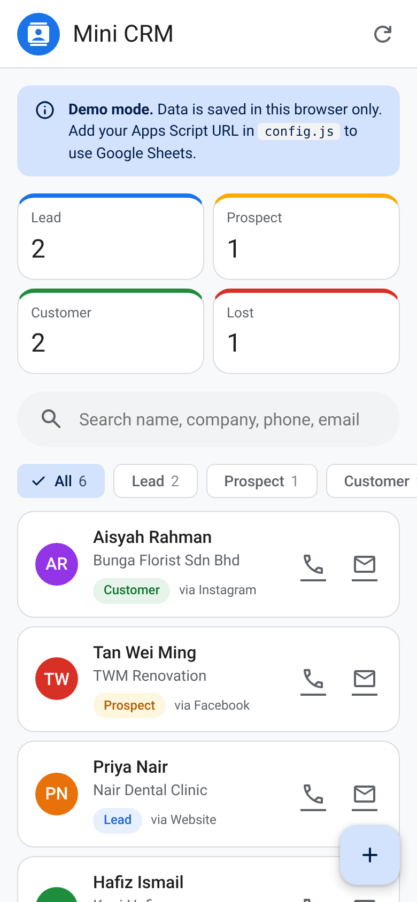
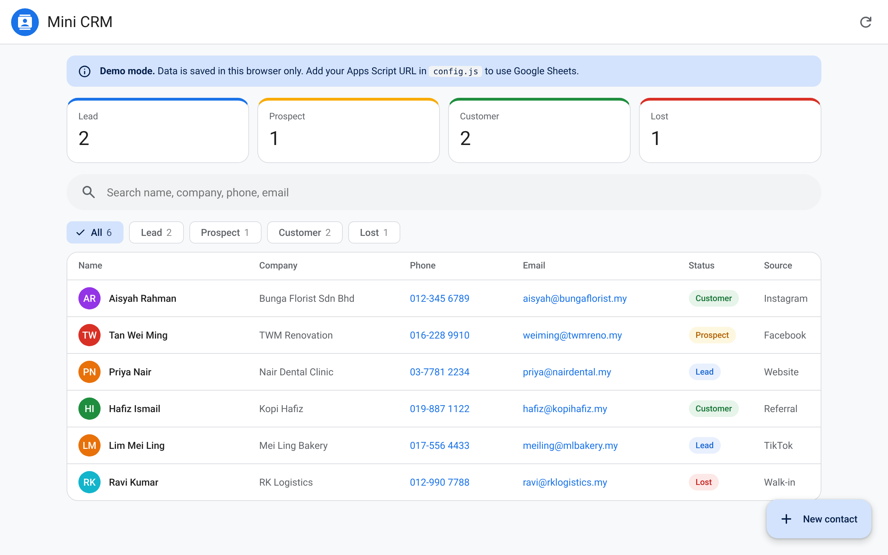

# Mini CRM + Google Sheets

A simple, mobile-friendly CRM. Google-style look, Google Sheet as the database, Google Apps Script as the backend, hosted free on Netlify.

| Phone | Laptop |
|---|---|
|  |  |

**What it does:** add, view, edit and delete contacts · search · filter by status (Lead / Prospect / Customer / Lost) · tap to call or email · undo delete · dark mode.

---

## How it works

```
Phone / Laptop  →  Netlify website (public/)  →  Apps Script Web App  →  Google Sheet
```

No Apps Script URL yet? The site runs in **demo mode** and saves data in your browser only, so you can try it right away.

---

## Setup (about 15 minutes)

### 1. Make the Google Sheet + backend
1. Create a new Google Sheet (any name).
2. Click **Extensions → Apps Script**.
3. Delete what's in `Code.gs`, then paste in everything from [`apps-script/Code.gs`](apps-script/Code.gs). Click **Save** 💾.
4. Click **Deploy → New deployment** → gear icon ⚙️ → **Web app**.
   - Execute as: **Me**
   - Who has access: **Anyone**
5. Click **Deploy** and allow access (Google shows a warning screen: **Advanced → Go to project → Allow**).
6. Copy the **Web app URL** (it ends in `/exec`).

The `Contacts` tab and its headers are created the first time you use the app.

### 2. Connect the website
Open [`public/config.js`](public/config.js) and paste in the URL:
```js
window.CRM_CONFIG = { API_URL: 'https://script.google.com/macros/s/XXXX/exec' };
```

### 3. Put it on Netlify
1. Push this repo to GitHub.
2. In Netlify, go to **Add new site → Import from Git** and pick this repo.
3. Leave the build command empty. The publish folder (`public`) is already set in `netlify.toml`.
4. Click **Deploy**. Done ✅

### Try it on your computer
```bash
cd public && python3 -m http.server 8080
# open http://localhost:8080
```

---

## ⚠️ Good to know

| Topic | What to know |
|---|---|
| **Changing Code.gs later** | Use **Deploy → Manage deployments → ✏️ Edit → Version: New version**. If you make a *new* deployment, the URL changes and the app stops working. |
| **No login (demo)** | Anyone with the website link can see and edit the contacts. Fine for a demo. Add a password before using real customer data. |
| **Speed** | Apps Script takes 1–3 seconds. The screen updates right away and saves in the background. |
| **Editing the Sheet by hand** | You can, but don't rename the header row. Columns are read by name, so moving them around is OK. |
| **Size** | Good for a few thousand contacts and a small team. |

## Files
```
apps-script/Code.gs   → backend (paste into Apps Script)
public/index.html     → page layout
public/styles.css     → Google-style (Material 3) design, mobile-first
public/app.js         → app logic + demo mode
public/config.js      → your Apps Script URL
netlify.toml          → Netlify settings
```
