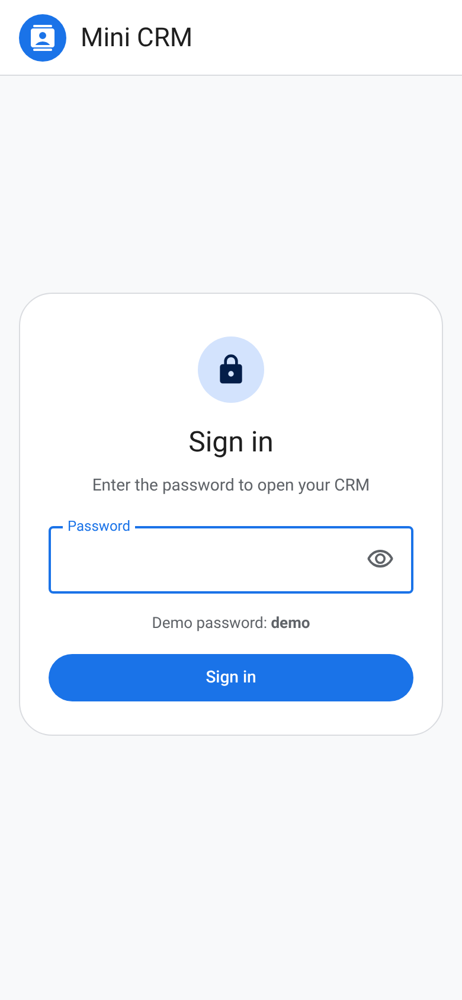

# Mini CRM + Google Sheets

A simple, mobile-friendly CRM. Google-style look, Google Sheet as the database, Google Apps Script as the backend, hosted free on Netlify.

| Login | Phone | Laptop |
|---|---|---|
|  |  |  |

**What it does:** password login · add, view, edit and delete contacts · search · filter by status (Lead / Prospect / Customer / Lost) · tap to call or email · undo delete · dark mode.

---

## How it works

```
Phone / Laptop  →  Netlify website (public/)  →  Apps Script Web App  →  Google Sheet
```

No Apps Script URL yet? The site runs in **demo mode** (password: `demo`) and saves data in your browser only, so you can try it right away.

**Login:** you type the password → Apps Script checks it → gives back a pass that lasts 6 hours (it keeps extending while you use the app). Every request must carry a valid pass. The password lives in the **Settings** tab of your Google Sheet, never in this repo.

---

## Setup (about 15 minutes)

### 1. Make the Google Sheet + backend
1. Create a new Google Sheet (any name).
2. Click **Extensions → Apps Script**.
3. Delete what's in `Code.gs`, then paste in everything from [`apps-script/Code.gs`](apps-script/Code.gs). Click **Save** 💾.
4. Click **Deploy → New deployment** → gear icon ⚙️ → **Web app**.
   - Execute as: **Me**
   - Who has access: **Anyone**
5. Click **Deploy** and allow access (Google shows a warning screen: **Advanced → Go to project → Allow**).
6. Copy the **Web app URL** (it ends in `/exec`).
7. **Set your password:**
   - In Apps Script, pick **`setup`** from the function list at the top and click **▶ Run** (once only).
   - Go back to your Sheet. You'll see two new tabs: **Contacts** and **Settings**.
   - In **Settings**, type your password in the cell next to `APP_PASSWORD` (use 10+ characters).

   | setting | value | note |
   |---|---|---|
   | APP_PASSWORD | `your-password-here` | … |

   To change it later, just edit that cell. No redeploy needed.

> 💡 Backup option: if the Settings cell is empty, the app uses the `APP_PASSWORD` Script Property (⚙️ Project Settings → Script properties) instead.

### 2. Connect the website
Open [`public/config.js`](public/config.js) and paste in the URL:
```js
window.CRM_CONFIG = { API_URL: 'https://script.google.com/macros/s/XXXX/exec' };
```

### 3. Put it on Netlify
1. Push this repo to GitHub.
2. In Netlify, go to **Add new site → Import from Git** and pick this repo.
3. Leave the build command empty. The publish folder (`public`) is already set in `netlify.toml`.
4. Click **Deploy**. Done ✅

### Try it on your computer
```bash
cd public && python3 -m http.server 8080
# open http://localhost:8080
```

---

## ⚠️ Good to know

| Topic | What to know |
|---|---|
| **Changing Code.gs later** | Use **Deploy → Manage deployments → ✏️ Edit → Version: New version**. If you make a *new* deployment, the URL changes and the app stops working. |
| **Who can see the password** | Anyone who can open your Google Sheet can see the **Settings** tab. Only share the Sheet with people you trust. App users don't need Sheet access. |
| **One shared password** | Everyone uses the same password. If someone leaves, change the password cell. Everyone is logged out right away, and only people with the new password can get back in. |
| **Wrong-password lock** | After 10 wrong tries in 10 minutes, login is paused for 10 minutes for everyone. |
| **Log out** | The ⏻ button at the top right. It also clears the saved contact list from that device. |
| **Speed** | Apps Script takes 1–3 seconds. The screen updates right away and saves in the background. |
| **Editing the Sheet by hand** | You can, but don't rename the header row. Columns are read by name, so moving them around is OK. |
| **Size** | Good for a few thousand contacts and a small team. |

## Files
```
apps-script/Code.gs   → backend (paste into Apps Script)
public/index.html     → page layout
public/styles.css     → Google-style (Material 3) design, mobile-first
public/app.js         → app logic + demo mode
public/config.js      → your Apps Script URL
netlify.toml          → Netlify settings
```
